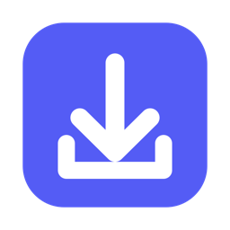
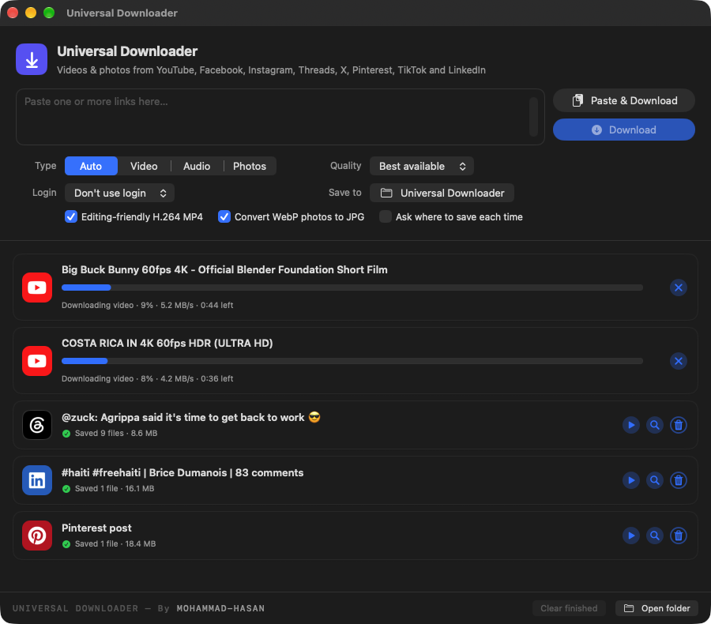
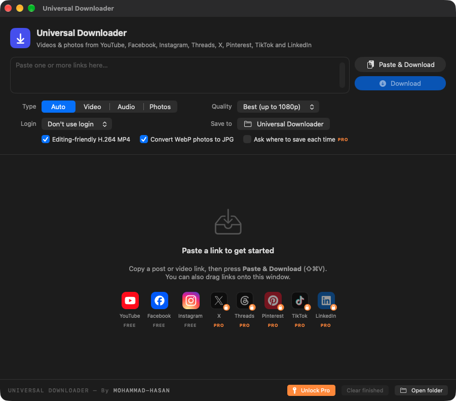
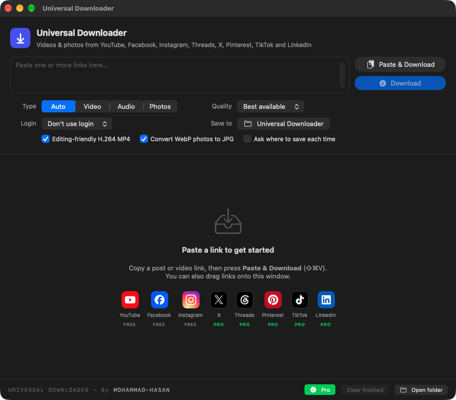
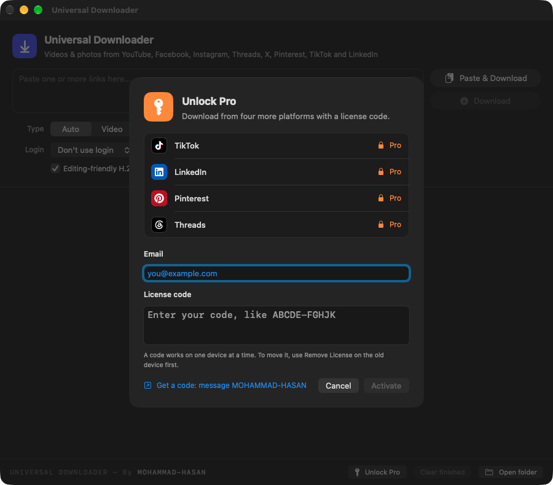
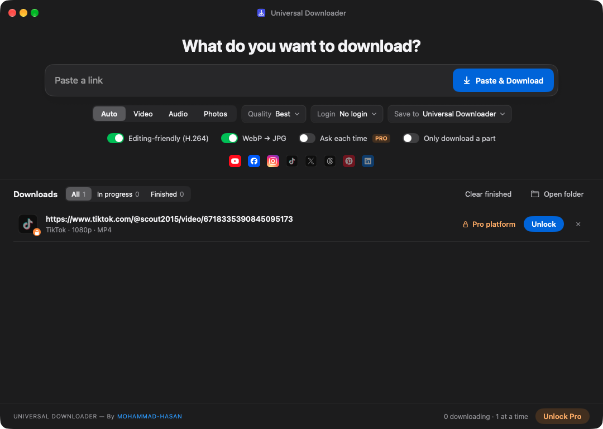
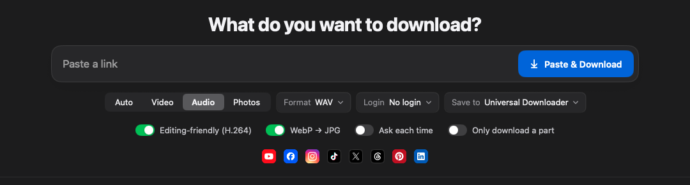
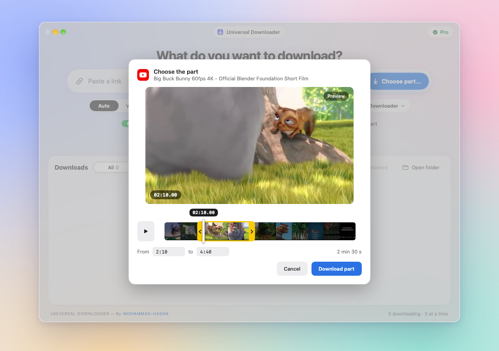
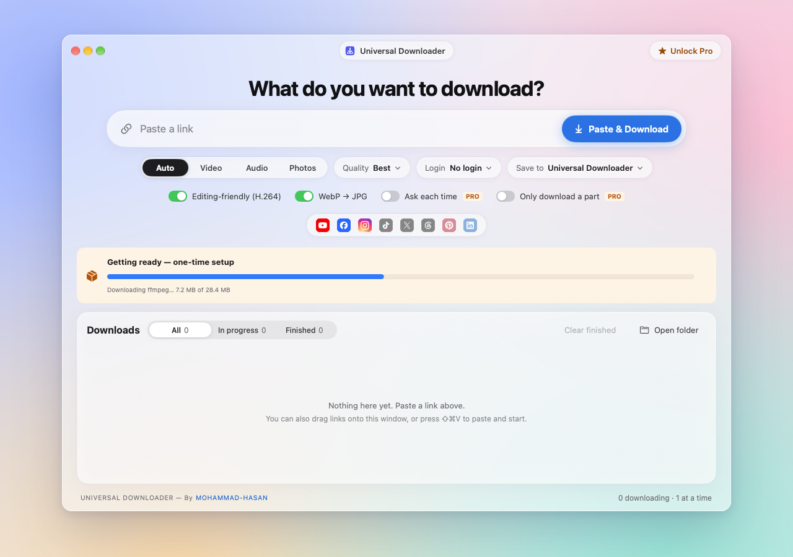
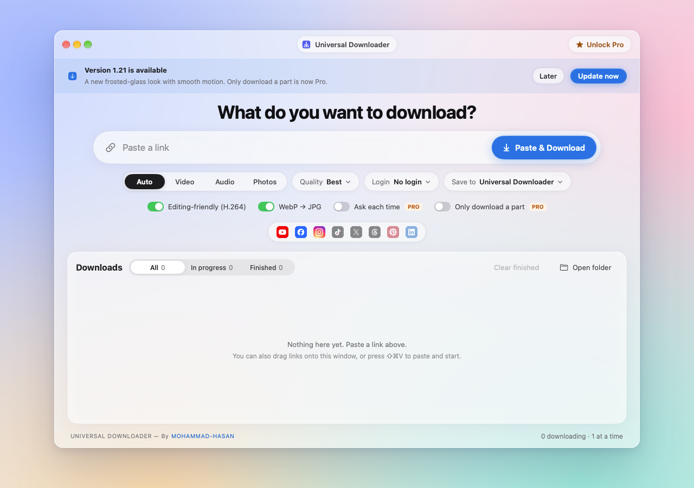

  

<h1 align="center">Universal Downloader</h1>

  Save videos, photos and audio from <b>YouTube, Facebook, Instagram, Threads, X, Pinterest, TikTok and LinkedIn</b>. 
  Native apps for <b>Mac</b> and <b>Windows</b>. Paste a link and it downloads. 
  YouTube, Facebook and Instagram are <b>free</b>. <b>Pro</b> (৳200, lifetime) adds X, Threads, Pinterest, TikTok and LinkedIn, plus 4K, WAV and faster downloads.

  <a href="../../releases/latest"><b>⬇ Download the latest version</b></a>
  &nbsp;·&nbsp; <a href="#install">Install</a>
  &nbsp;·&nbsp; <a href="#how-to-use">How to use</a>
  &nbsp;·&nbsp; <a href="#free-and-pro">Free &amp; Pro</a>
  &nbsp;·&nbsp; <a href="https://www.supportkori.com/mohammad989/extras/universal-downloader-pro-lifetime-license-mac-windows-83m6">Get Pro</a>
  &nbsp;·&nbsp; <a href="#faq">FAQ</a>

  &nbsp;
  &nbsp;
  &nbsp;
  &nbsp;
  &nbsp;
  &nbsp;
  &nbsp;
  

  <picture>
    <source media="(prefers-color-scheme: dark)" srcset="docs/hero-dark.png">
    <source media="(prefers-color-scheme: light)" srcset="docs/hero-light.png">
    
  </picture>

## Features

- **Paste and go.** Copy a link and press **Paste & Download** (⇧⌘V on Mac, Ctrl+Shift+V on Windows). Paste several links at once, or drag them onto the window.
- **8 platforms, one app.** Auto mode picks the right method for each site and gets photos *and* videos, including carousels with both.
- **Free and Pro.** YouTube, Facebook and Instagram are free forever. A Pro license adds five more platforms and the power tools. See [Free & Pro](#free-and-pro).
- **Editing-friendly video.** By default videos are saved as **H.264 MP4**, which opens in QuickTime, Premiere Pro, After Effects, Final Cut and DaVinci Resolve,
  at the highest quality available. When a site only has its best quality in another format (Instagram's 1080p, YouTube's 4K), the app converts it to H.264 for you.
- **Quality up to 4K.** Choose Best available, 4K, 1440p, 1080p, 720p or 480p.
- **Just the part you need.** Turn on **Only download a part**, paste the link, then drag the yellow handles on the video's
  timeline while the preview plays, or type a start and end like `1:05` to `2:30`. Only that stretch downloads. It works for
  video and audio. Free.
- **Audio only.** Save as **MP3** (small) or **WAV** (lossless 16-bit PCM, ready for editing).
- **Photos.** Full-resolution images and whole carousels, with WebP photos converted to JPG automatically.
- **Save where you want.** Pick a default folder, or have the app **ask where to save each time**.
- **Private posts.** For Instagram, X and other posts that need a login, the app can use the login from your browser. You never type a password into the app.
- **Live progress.** Speed, time left, three downloads at once, Stop / Retry / Show in Finder for each one, and
  All / In progress / Finished tabs.
- **Sets itself up.** On first launch it installs its download engines automatically, in about 30 seconds. No Terminal, no extra installs.
- **Stays current by itself.** Every time you open it, the app quietly updates its download engines, so sites that change keep working. There's no button to remember.
- **Updates itself.** When a new version comes out, the app shows **Update now**. One click installs it and restarts.
- **A clean, simple window.** One big link box with everything else right under it, in light and dark mode to match your system.

## Supported platforms

| | Platform | Plan | Videos | Photos | Notes |
|:-:|---|:-:|:-:|:-:|---|
|  | YouTube | Free | ✅ | | Up to 1080p free, 4K with Pro. Audio as MP3 (WAV with Pro). |
|  | Facebook | Free | ✅ | ✅ | Some posts need your login. |
|  | Instagram | Free | ✅ | ✅ | Posts, reels and carousels. Instagram usually needs your login. |
|  | X (Twitter) | **Pro** | ✅ | ✅ | Photo posts need your login. |
|  | Threads | **Pro** | ✅ | ✅ | Public posts, including mixed photo and video carousels. |
|  | Pinterest | **Pro** | ✅ | ✅ | Video and image pins. |
|  | TikTok | **Pro** | ✅ | ✅ | Videos and photo slideshows. |
|  | LinkedIn | **Pro** | ✅ | ✅ | Public posts. Photos come at LinkedIn's public size (800px). |

## Free and Pro

| | Free | Pro |
|---|:-:|:-:|
| YouTube, Facebook, Instagram | ✅ | ✅ |
| X, Threads, Pinterest, TikTok, LinkedIn | | ✅ |
| Video quality | up to 1080p | up to 4K |
| Audio | MP3 | MP3 and WAV |
| Photos and carousels, H.264 MP4, WebP to JPG, browser login | ✅ | ✅ |
| Download only a part of a video | ✅ | ✅ |
| Links per paste | one | many at once |
| Downloads at the same time | one | three |
| Save location | Downloads › Universal Downloader | any folder, or ask each time |
| Updates | ✅ | ✅ |

Under the link box, the Pro platforms stay dimmed until you unlock them, and Pro options carry a **PRO** tag. Picking one
without a license opens Unlock Pro and says what it needs.

<table>
  <tr>
    <td align="center"> Without Pro</td>
    <td align="center"> With Pro</td>
  </tr>
</table>

**Get Pro.** Buy it on [SupportKori](https://www.supportkori.com/mohammad989/extras/universal-downloader-pro-lifetime-license-mac-windows-83m6) for ৳200 (bKash, Nagad, Rocket or card). You get your license key right away,
on the page and by email. You can also message [MOHAMMAD-HASAN on Instagram](https://www.instagram.com/kam_rul_69/) for a code.

**Activate it.** Click **Unlock Pro** at the bottom of the window (on Mac it's also in the app menu), enter your email and the key, and click **Unlock**.
You need an internet connection for this step only.

**Pasted a Pro link without a license?** It waits in the list as **Pro platform** with an **Unlock** button instead of downloading.
Activate your code and the waiting downloads start by themselves.

**How licenses work**

- **One code, one computer.** A code is activated on one Mac or PC at a time. Trying it on a second computer shows which device it's active on.
- **New computer?** On the old one, open **Pro** and click **Remove License**, then activate the same code on the new one.
  If the old computer is gone, message MOHAMMAD-HASAN and the code will be moved for you.
- **Works offline.** After activation Pro keeps working without internet. About once a day the app quietly checks that the code is still yours.
- **What's sent.** Activation sends the code, your email, an anonymous device ID (a one-way fingerprint of your computer's hardware ID, not the ID itself), your computer's name and its type (for example "Mac · MacBook Air (M2, 2022) · macOS 26.0" or "Windows 11 · Dell XPS 13"). That's used only to manage your license. Nothing else is sent.
- **Updates keep Pro.** Installing a new version doesn't remove your license.

## A closer look

**Audio as WAV or MP3.** Choose **Audio** and the Quality menu becomes **Format**.

<picture>
  <source media="(prefers-color-scheme: dark)" srcset="docs/audio-dark.png">
  <source media="(prefers-color-scheme: light)" srcset="docs/audio-light.png">
  
</picture>

**Only the part you need.** Download a few minutes of an hour-long video instead of the whole thing. Turn on
**Only download a part** and paste the link: **Choose the part** opens with a live preview. Drag the yellow ‹ › handles to
where the part starts and ends (the white playhead shows the exact time), press ▶ to watch it, or type the times
(`45`, `1:05` or `1:02:30`). Then press **Download part**. Only those bytes download, so it's fast; the cut lands exactly
on your times, the file name says which part it is, and the option turns itself off after that link.

**First launch sets itself up.** The app downloads its engines with a progress bar. You can paste links straight away; they start as soon as setup is done.

**Updates arrive by themselves.** When a new version is published here, every installed copy offers it.

## Install

Get both files from **[Releases](../../releases/latest)**.

### Mac (macOS 14 Sonoma or newer, Apple Silicon and Intel)

1. Open `Universal-Downloader-<version>.dmg` and drag **Universal Downloader** onto **Applications**.
2. Open the app. The first time, macOS blocks it because it isn't from the App Store.
   Go to **System Settings → Privacy & Security**, scroll down and click **Open Anyway**. You only do this once.
3. Setup runs automatically (about 30 seconds). Then you're ready.

### Windows (Windows 10 or 11, 64-bit)

1. Download `Universal-Downloader-<version>.exe` and put it wherever you like (Desktop, Documents…). There's nothing to install.
2. If **"Windows protected your PC"** appears, click **More info → Run anyway**. You only do this once.
3. Setup starts by itself on first launch. It downloads about 170 MB, once.

## How to use

1. Copy a link to a post or video from any supported site.
2. In the app, press **Paste & Download**, or paste into the box and press **Download**.
3. Choose **Type** if you want: **Auto** (everything), **Video**, **Audio** (MP3/WAV) or **Photos**.
4. When it finishes, press **Show in Finder** (**Show in folder** on Windows), or double-click it to open the file.
5. For X, Threads, Pinterest, TikTok or LinkedIn, 4K, WAV or many links at once, click **Unlock Pro** once and enter your license key ([Free & Pro](#free-and-pro)).

Files go to **Downloads → Universal Downloader** unless you choose another folder under **Save to**.

## FAQ

**Instagram or X says it needs a login.**
Log in to the site in your browser, then pick that browser under **Login** in the app and press **Retry**.
On Mac, choose Chrome, Brave or Safari: Brave and Chrome ask once for keychain access (click **Always Allow**); Safari needs Full Disk Access for the app.
On Windows, use **Firefox**: Windows doesn't let other apps read Chrome, Edge or Brave logins.

**YouTube says "Sign in to confirm you're not a bot".**
YouTube sometimes asks a whole internet connection to prove it's human, often on shared or mobile networks and VPNs.
The app automatically retries in a different way, which usually works. If it still fails, sign in to YouTube in your browser
(on Windows, use **Firefox**), pick that browser under **Login** and press **Retry**. Turning off a VPN or switching networks also helps.

**A site stopped working.**
Sites change often. Close and reopen the app: it updates its download engines every time it opens. If a new app version is out, it also offers **Update now**.

**Why does my Mac or PC warn me the first time?**
The app isn't sold through the App Store or Microsoft Store, so your computer doesn't recognise it yet. Approve it once as described in [Install](#install). Updates installed from inside the app normally don't ask again.

**Why are LinkedIn photos only 800px?**
That's the largest size LinkedIn shows to visitors who aren't logged in.

**My license code says "already active on another device".**
Each code works on one computer at a time. Remove it on the other computer first (**Pro → Remove License**), or message
[MOHAMMAD-HASAN](https://www.instagram.com/kam_rul_69/) to move it.

**Does Pro work on both Mac and Windows?**
Yes. The same kind of code works in both apps, on one computer at a time.

**Can I download just a few minutes of a long video?**
Yes. Turn on **Only download a part**, paste the link, and choose the part on the timeline (or type the times). Only that
part downloads, so a 2-minute clip from a 2-hour video takes seconds, not the whole video's time and space.

**Can it download a whole YouTube playlist or channel?**
It's built for single posts and videos. Playlist links download their videos one by one.

## Made by

<samp>UNIVERSAL DOWNLOADER — By <a href="https://www.instagram.com/kam_rul_69/"><b>MOHAMMAD-HASAN</b></a></samp>

## Built with

- [yt-dlp](https://github.com/yt-dlp/yt-dlp) for video and audio
- [gallery-dl](https://codeberg.org/mikf/gallery-dl) for photo posts
- [FFmpeg](https://ffmpeg.org) for merging and converting
- Built-in extractors for Threads and LinkedIn photos
- Platform logos from [Simple Icons](https://simpleicons.org) (CC0). All logos are trademarks of their owners.

---

Please only download content you own or have permission to use, and respect each platform's terms.
